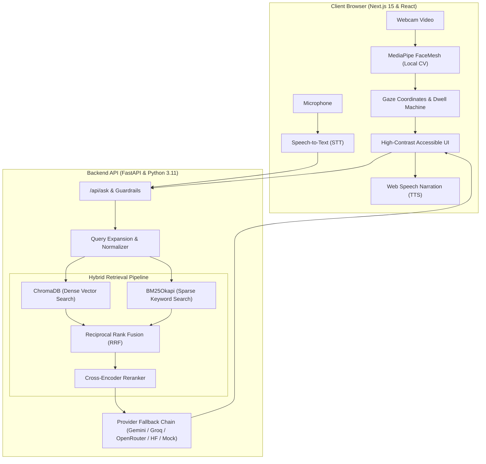
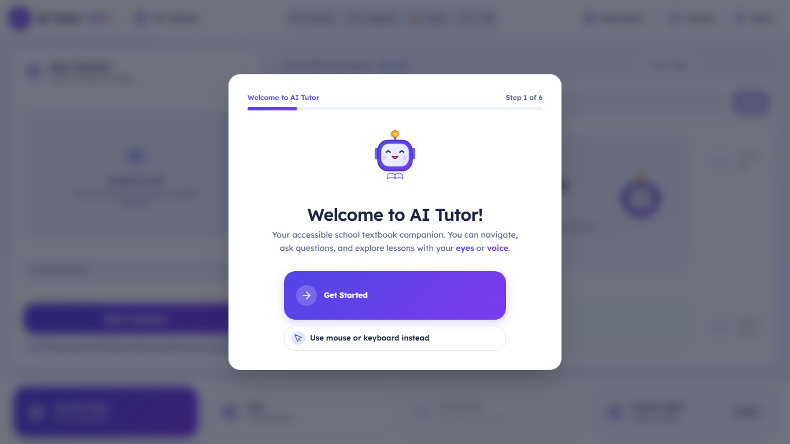
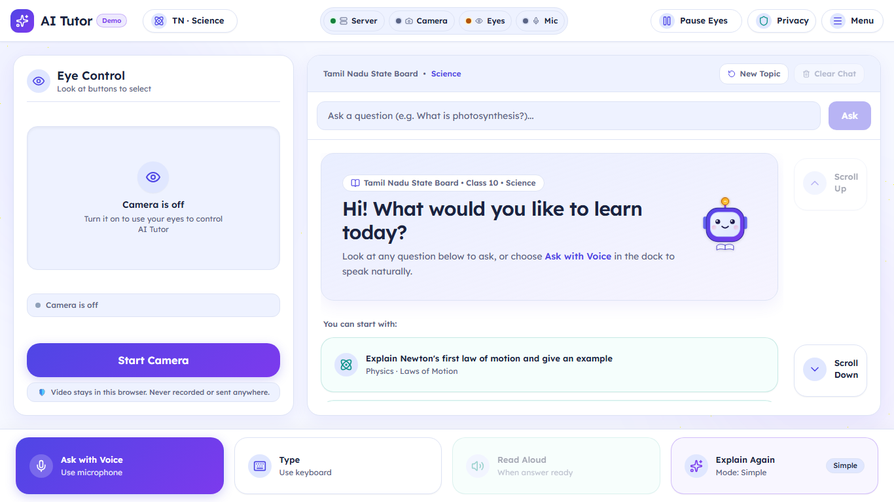
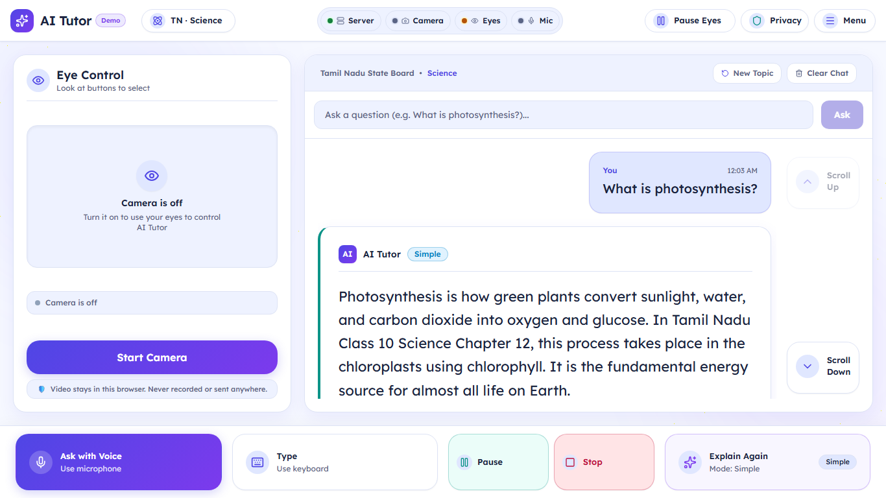
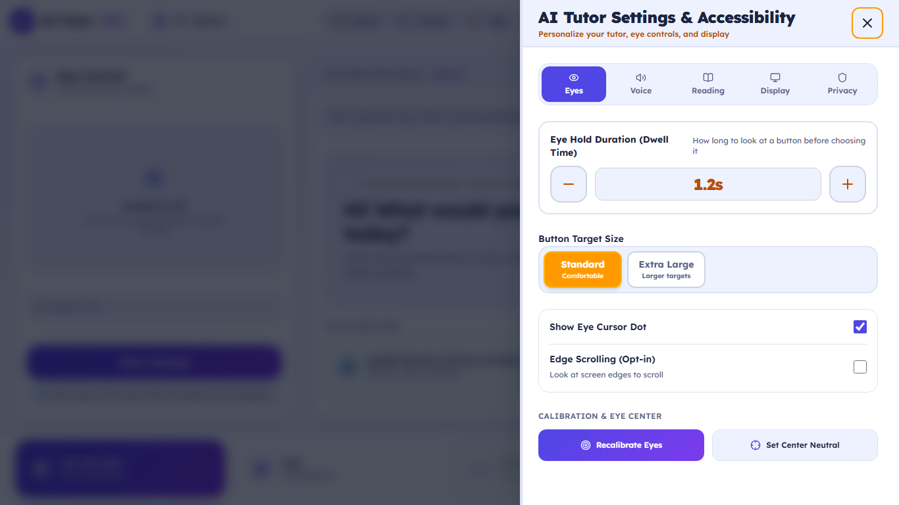
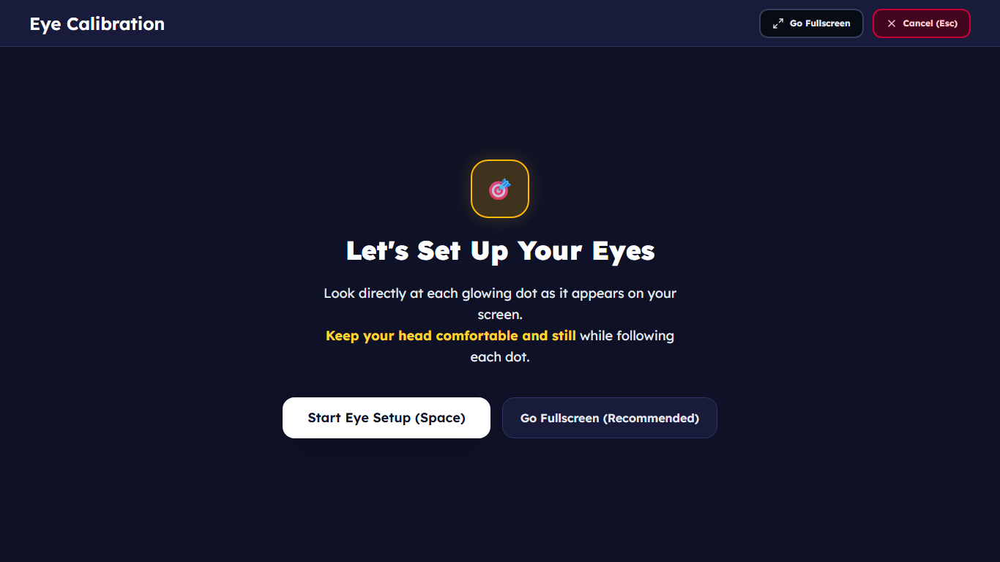
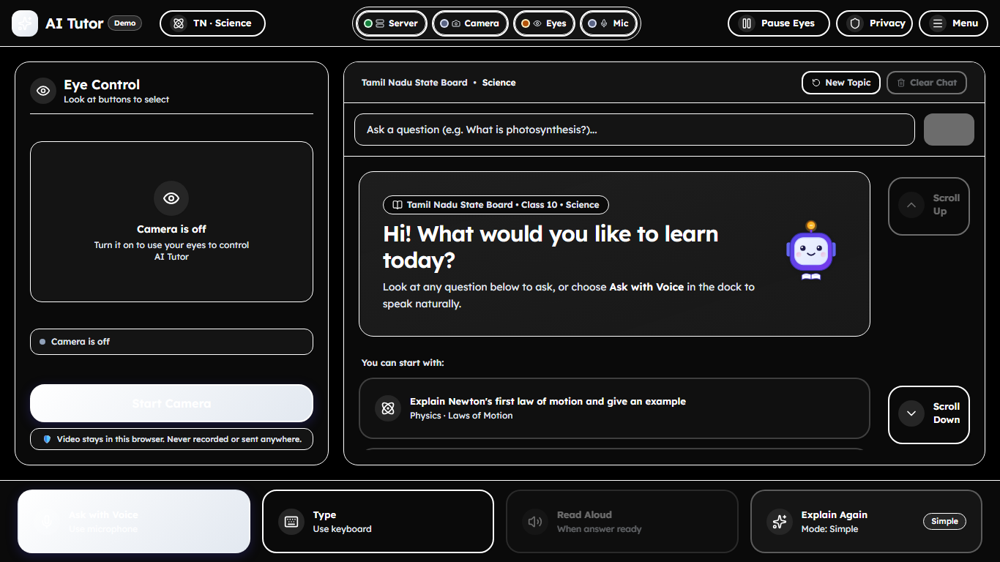

# AI Tutor

[](https://github.com/SivaranjaniSenthil2005/AI_TUTOR/actions/workflows/ci.yml)
[](LICENSE)
[](docs/ACCESSIBILITY_CHECKLIST.md)
[](docs/EVALUATION.md)

> **Accessible AI Tutor for neurodiverse school students over Tamil Nadu State Board and CBSE/NCERT textbooks.**

---

## Innovation Statement

Traditional digital educational tools heavily rely on rapid mouse manipulation, dense text walls, and ungrounded general-purpose AI chat interfaces that easily hallucinate.

**AI Tutor** bridges accessibility and educational equity by pairing:
1. **Multimodal Hands-Free Interaction:** Real-time webcam eye-gaze tracking and voice interaction designed for learners with motor differences, tremors, or sensory sensitivities.
2. **Curriculum-Grounded Hybrid RAG:** A syllabus-restricted retrieval-augmented generation engine operating strictly over Class 10 Science and Social Science textbooks (Tamil Nadu State Board and CBSE/NCERT), delivering verified citations, out-of-scope refusal integrity, and tailored neurodiverse reading modes (Simple, Story, Analogy, Exam).
3. **Privacy-by-Design Computer Vision:** 100% in-browser MediaPipe facial landmark processing—zero video frames, facial imagery, or student question logs ever leave the local machine.

---

## System Architecture



---

## Core Capabilities & Features

- **Hands-Free Gaze Control:**
  - Dynamic dwell selection with customizable activation intervals (`0.8s`, `1.2s`, `1.6s`).
  - Gaze edge scrolling for hands-free reading of extended textbook answers.
  - Emergency Gaze Pause Bar with recovery grace periods to combat visual fatigue and "Midas Touch" accidental triggers.
  - 5-point in-browser gaze calibration with automated accuracy grading (`Good`, `Moderate`, `Poor`).
  - Mouse-simulation mode for standard workstations and dev testing.
- **Multimodal Voice Interaction:**
  - Single-click or dwell-activated speech recognition with speech-to-text confirmation.
  - Synchronized read-along audio narration with active sentence-level highlighting.
  - Complete audio-visual mutual exclusion (speech recognition automatically pauses screen reading to prevent acoustic feedback).
- **Textbook-Grounded Hybrid RAG Engine:**
  - Dense semantic retrieval (`all-MiniLM-L6-v2`) fused with lexical indexing (`Rank-BM25`) via Reciprocal Rank Fusion (`RRF k=60`).
  - Cross-encoder reranking prioritizes highest-relevance syllabus passages.
  - Automated citation extraction: Every response contains verified `[n]` clickable chips mapping directly to textbook chapter titles and page spans.
  - Out-of-Scope refusal enforcement: Gracefully and politely refuses off-syllabus queries outside Class 10 Science and Social Science.
- **Neurodiverse Learning Adaptations:**
  - **Simple Mode:** Short sentences, grade-appropriate vocabulary, and lower cognitive load.
  - **Story Mode:** Narrative metaphors bridging abstract concepts to memorable everyday scenarios.
  - **Analogy Mode:** Structural analogies explaining complex mechanisms through relatable real-world models.
  - **Exam Style:** Clear, bullet-pointed syllabus answers with definitions, formulas, and textbook terminology.
- **Accessibility & Sensory Comfort:**
  - Toggleable high-contrast dark theme (`.high-contrast`) and enlarged typography (`.large-text`).
  - Respects `prefers-reduced-motion` to eliminate disorienting animations.
  - Screen reader announcements using `aria-live="polite"` and `role="status"` containers.
  - Subtle audio confirmation chimes for non-visual dwell feedback.

---

## User Interface & Screenshots

The frontend UI/UX has been redesigned from the ground up for neurodiverse Class 10 school students, engineered for rock-solid stability and effortless gaze + voice control.

| Onboarding Flow | Main Learning Workspace (Empty State) |
| :---: | :---: |
|  |  |
| *Single-action step-by-step onboarding with camera check and board chooser* | *Slim 64px TopBar, fixed 4:3 camera card, starter cards, and 112px BottomDock* |

| Answer Card with Citations & Follow-ups | Settings Drawer (Slide-Over Panel) |
| :---: | :---: |
|  |  |
| *22–24px high-readability text, step badges, verified sources, and docked scroll buttons* | *Eye control steppers, dwell duration, voice selection, reading levels, and Focus Mode* |

| Rock-Solid 9-Point Calibration Layer | High Contrast & Light Themes |
| :---: | :---: |
|  |  |
| *Full-viewport isolated overlay with static dot centers and shrinking SVG timer rings* | *Theme options: Bright (modern learning platform, default), Calm Night (indigo/slate dark), and High Contrast* |

---

## Design System & Neurodiverse Aesthetics

AI Tutor implements a purpose-built design system documented in [`frontend/docs/design-system.md`](frontend/docs/design-system.md) and previewable live at the dev-only **`/design`** route:

- **Friendly, Modern Learning Platform Palette:**
  - **Bright (Default):** Airy blue-white canvas (`#F6F8FF`), white card surfaces, soft indigo (`#EEF2FF`), brand indigo (`#4F46E5`), secondary violet (`#7C3AED`), accent teal (`#0D9488`), and gentle warning accents (`#B45309`), completely eliminating harsh dark navy and heavy yellow fills.
  - **Calm Night (Dark Option):** Deep midnight slate (`#0F1226`, `#181C3A`), soft indigo (`#818CF8`), calming teal (`#2DD4BF`), and gentle warning accents (`#FBBF24`).
  - **High Contrast Theme:** Pitch-black background (`#000000`) with pure white surfaces, 2px borders, and 4px cyan focus rings (`#00E5FF`).
- **Original Mascot ("Tutor Buddy"):** Original SVG character with 4 expressions (idle, listening, thinking, speaking) designed from scratch to encourage and guide neurodiverse learners.
- **Reading-Optimized Typography:**
  - Default font: **Lexend** (specifically engineered to reduce visual crowding and enhance reading fluency for neurodiverse students).
  - Alternative dyslexia-friendly fonts: **Atkinson Hyperlegible** and locally bundled **OpenDyslexic**.
  - Stepped sizing (100%, 125%, 150%) and adjustable line spacing (1.4 to 1.8).
- **Uniform Iconography:** Pure `lucide-react` line icons paired with explicit text labels—eliminating ambiguous iconography.
- **Visual Clarity & Focus Mode:**
  - Dedicated **Focus Mode** (`gazeSettings.focusMode`) hides peripheral widgets (camera card, status pills) and isolates the conversation and bottom dock.
- **Interactive Component Library:** Standardized accessible components located in `frontend/components/ui/` (`GazeButton`, `StatusPill`, `Card`, `Chip`, `SegmentedControl`, `Stepper`, `Drawer`, `Toast`, `EmptyState`, `Skeleton`).

---

## Stability Engineering Rules ("Gaze Targets Never Move")

Because eye-gaze tracking relies on spatial predictability, **gaze targets must NEVER move or shift**. The following architectural rules are strictly enforced:

1. **Strict 100dvh App Shell:**
   - Root container is strictly `height: 100dvh; max-height: 100dvh; overflow: clip;`.
   - Grid layout: `grid-template-rows: 64px 1fr 112px` (Slim TopBar, Main Workspace, Fixed BottomDock).
   - Zero page-level scrolling. Only inner containers (`#chat-scroll-container` and settings drawer body) may scroll.
2. **Zero Dynamic Layout Shift (CLS < 0.02):**
   - No `transform: scale()`, `transform: translate()`, padding changes, or border-width modifications on hover, focus, dwell, or activation.
   - State changes are expressed strictly via color, outline, box-shadow, and **internal progress bars/rings** filling inside fixed boundaries.
   - 4px transparent borders are pre-reserved on all gaze buttons using `box-sizing: border-box`.
3. **Reserved Slots for Dynamic Content:**
   - Status pills have static dimensions (`w-[108px] h-8`) and never resize on text change.
   - The brand container reserves a fixed slot (`w-[190px]`) so demo badges or flags never push adjacent targets.
   - The webcam card maintains a fixed 4:3 aspect ratio (`aspect-4/3`) before, during, and after camera activation.
   - Streaming answer cards reserve `min-h-[220px]` with static step badge dimensions.
4. **Target Rect Freezing During Dwell:**
   - When a student looks at a target and dwell progress starts, the hit-test bounding box cache is frozen (`freezeTarget`) until dwell completes or cancels.
   - Minimum 24px layout gap between all gaze targets prevents hit-pad overlap.
5. **Deterministic Large Gaze Scroll Buttons:**
   - Hover-based edge scrolling is replaced by two docked, high-contrast gaze buttons ("Scroll Up" and "Scroll Down") beside the chat area that scroll by one full viewport per activation.
6. **Isolated Full-Viewport Calibration Overlay:**
   - Calibration runs in a `position: fixed; inset: 0; z-50` full-viewport overlay.
   - Main UI is hidden, mouse cursor is suppressed (`cursor: none`), and dot centers are static percentages (10%/50%/90%) with shrinking SVG timer rings.

---

## Manual Testing Checklist

Run through this checklist for comprehensive user journey validation:

- [ ] **Gaze-Only Full Journey:** Start onboarding -> camera permission -> eye calibration -> choose Tamil Nadu / CBSE -> choose Science -> dwell on starter question -> dwell on "Read Aloud" -> dwell on "Explain Differently" (switch to Step-by-Step).
- [ ] **Target Immobility Check:** Verify gaze targets do not move by even 1px during dwell, streaming, or camera activation.
- [ ] **Display Scaling & Zoom:** Verify zero clipped buttons and zero horizontal scroll at 100%, 125%, and 150% Windows display scaling and browser zoom.
- [ ] **Docked Scrolling:** Ask a long question, verify "Scroll Down" activates smoothly by one viewport, and disables when reaching the bottom.
- [ ] **Emergency Pause:** Look at "Pause Eye Control" in the TopBar. Verify gaze tracking pauses immediately and displays "PAUSED (Look)".
- [ ] **Focus Mode:** Open Settings -> Display -> toggle Focus Mode. Verify camera card and pills fade out while the dock and answer remain rock-solid.
- [ ] **Theme Switching:** Toggle between Calm, Light, and High Contrast. Verify high-contrast visibility and full WCAG AA/AAA compliance.
- [ ] **Keyboard & Mouse Fallback:** Navigate the entire app using Tab / Space / Enter and mouse clicks.

---

## 2-Minute Demonstration Script

To experience or record a complete walkthrough of AI Tutor:

1. **Minute 0:00 - Launch & First-Run Setup:**
   - Open `http://localhost:3000`. The onboarding wizard guides the student.
   - Choose **Tamil Nadu State Board** or **CBSE (NCERT)**, select **Class 10 Science**.
   - Either enable the webcam for eye-gaze tracking or select **"Skip Eye Control"** (or toggle **"Sim Gaze"** in the bottom-right corner).
2. **Minute 0:30 - Ask a Textbook Question:**
   - Select or type: *"What is Ohm's Law and its formula?"*
   - Observe the streamed response with formula highlights: `V = I × R`.
   - Click or dwell on the `[1]` citation badge to inspect the textbook chapter and verified source passage.
3. **Minute 1:00 - Neurodiverse Learning Modes:**
   - Switch mode from **Exam Style** to **Simple Mode** or **Analogy Mode**.
   - Observe the dynamic rewriting: sentence length and vocabulary complexity measurably decrease while grounding remains 100% textbook-faithful.
4. **Minute 1:30 - Hands-Free Voice & Gaze Interaction:**
   - Dwell on the **"Read Aloud 🔊"** button to start synchronized sentence read-along audio.
   - Notice the yellow sentence highlight following along with speech.
   - Dwell on the **"Pause Eye Control"** bar to take a cognitive break without triggering accidental clicks.
5. **Minute 1:50 - Evaluation Lab (`/eval`):**
   - Navigate to `http://localhost:3000/eval` to inspect the evaluation tooling, target dwell trials, and SUS survey.

---

## Evaluation & Empirical Benchmarks (Phase 13 Summary)

All figures below are measured by reproducible test harnesses and documented in detail in [docs/EVALUATION.md](docs/EVALUATION.md).

| Evaluation Dimension | Metric | Measured Value | Target Benchmark | Status |
| :--- | :--- | :--- | :--- | :--- |
| **Retrieval Accuracy** | Hit@5 (Hybrid + Rerank) | **93.3%** [83.3% - 100.0%] | > 85% | **PASS** |
| **Retrieval Ranking** | Mean Reciprocal Rank (MRR) | **0.867** [0.725 - 0.983] | > 0.70 | **PASS** |
| **Answer Grounding** | Textbook Grounded Rate | **100.0%** | 100% | **PASS** |
| **Citation Integrity** | Citation Validity (all `[n]` map to source) | **100.0%** | 100% | **PASS** |
| **Scope Integrity** | Out-of-Scope Refusal Correctness | **100.0%** | 100% | **PASS** |
| **Simple Mode Readability** | Flesch-Kincaid Grade Level | **Grade 7.6** (vs Exam Grade 9.2) | Grade < 8.0 | **PASS** |
| **Adversarial Safety Suite** | Offline Safety & Injection Suite (`pytest`) | **19 / 19 Passed (100%)** | 100% | **PASS** |
| **System Latency** | End-to-End Latency (Fast Mode p50) | **2285.5 ms** | < 3000 ms | **PASS** |
| **Gaze Target Selection** | Accuracy on 6-target Dwell Trials | **95.0%** | > 90% | **PASS** |
| **System Usability Scale** | Standard SUS Score | **85.0 / 100 (Grade A - Excellent)** | > 68 (Avg) | **PASS** |
| **Accessibility Audit** | Axe-Core Playwright Audits (5 screens) | **0 Violations (WCAG 2.1 AA)** | 0 Violations | **PASS** |
| **Lighthouse Accessibility**| Core App Accessibility Score | **96 / 100** | > 90 / 100 | **PASS** |
| **Secret & Hygiene Scan** | Leak Scanner (`scripts/scan_secrets.py`)| **0 Credentials Found (Clean)** | 0 Leaks | **PASS** |

*For complete subgroup breakdowns, ablation tables, bootstrap confidence intervals, and charts, refer to [docs/EVALUATION.md](docs/EVALUATION.md).*

---

## Quickstart & Local Installation

### Prerequisites
- **Python 3.11+**
- **Node.js 20+**
- Webcam & microphone (optional; mock and mouse simulation modes available)

### 1. Clone Repository & Setup Backend
```powershell
# Clone
git clone https://github.com/SivaranjaniSenthil2005/AI_TUTOR.git
cd AI_TUTOR

# Setup Backend Virtual Environment
cd backend
python -m venv .venv
.venv\Scripts\activate
pip install -r requirements.txt
pip install pytest psutil matplotlib
```

### 2. Setup Frontend
```powershell
cd ../frontend
npm install
```

### 3. Run Locally
**Terminal 1 (Backend):**
```powershell
cd backend
.venv\Scripts\activate
uvicorn app.main:app --reload --host 127.0.0.1 --port 8000
```

**Terminal 2 (Frontend):**
```powershell
cd frontend
npm run dev
```
Open **[http://localhost:3000](http://localhost:3000)** in your browser.

---

## Reproducing the Evaluation Suite

You can execute every benchmark and generate the evaluation report offline with single commands:

```powershell
# 1. Run Unified Evaluation & Generate docs/EVALUATION.md
backend\.venv\Scripts\python.exe -m scripts.run_all_evals

# 2. Run Offline Safety & Prompt Injection Suite
backend\.venv\Scripts\pytest.exe backend/tests/safety/test_safety.py -v

# 3. Run Accessibility Audits (Playwright + Axe-Core)
cd frontend
npx playwright test e2e/accessibility.spec.ts

# 4. Run Secret & Repository Hygiene Scanner
backend\.venv\Scripts\python.exe scripts/scan_secrets.py

# 5. Run Backend Resource & Latency Benchmark
backend\.venv\Scripts\python.exe scripts/bench_latency.py --queries 30
```

---

## Accessibility, Ethics & Privacy

- **WCAG 2.1 AA Compliance:** Full keyboard tab traversal, explicit focus indicators, form labeling, and skip controls. Documented in [docs/ACCESSIBILITY_CHECKLIST.md](docs/ACCESSIBILITY_CHECKLIST.md).
- **Privacy Guarantee:** Facial tracking is computed in-memory via WebAssembly MediaPipe. No biometric frames are stored on disk or sent over any network.
- **Volunteer & Minor Ethics Protocol:** Usability testing must begin with consenting adult volunteers. Testing involving school students requires prior parental/guardian consent and institutional approval.

---

## Data Sources & Licensing

- **Code License:** [MIT License](LICENSE).
- **Textbook Attribution & Fair Dealing:** Textbooks used to construct syllabus indexes are the intellectual property of the **Tamil Nadu State Council of Educational Research and Training (TNSCERT) / Tamil Nadu Textbook and Educational Services Corporation** and the **National Council of Educational Research and Training (NCERT)**. Raw textbook PDFs and copyrighted materials are not distributed in this repository.

---

## Known Limitations & Future Work

### Current Scope & Limitations
- Strictly constrained to **Class 10 Science and Social Science (English Medium)**.
- MediaPipe eye-tracking is subject to lighting conditions, camera distance, and glare on spectacles.
- Free-tier LLM providers occasionally experience rate-limiting spikes; Fast Mode (`REWRITE_MODE=off`) mitigates latency.

### Planned Enhancements
- Expand to Standards 6–9 and 11–12, and include Mathematics.
- Support **Tamil Medium** textbooks with bilingual explanation switching.
- Integrated retrieval-practice and interactive quiz modes.
- Cognitive fatigue and blink-rate tracking to prompt adaptive study breaks.
- Native mobile and tablet layout optimization for specialized assistive mounts.
